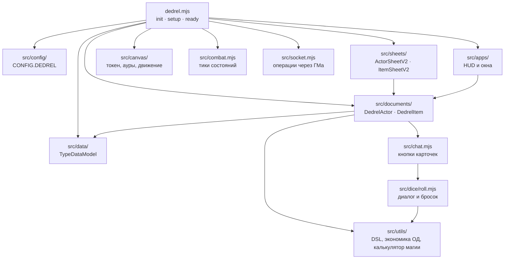

# Архитектура системы

Карта кода системы Dedrel для Foundry VTT V14: какие слои есть, в каком порядке они
включаются и где искать нужное. Подробности по отдельным темам — в соседних документах
(оглавление — [README.md](README.md)).

## Коротко

- **Без сборки.** Манифест (`system.json`) подключает один ES-модуль `dedrel.mjs` и один
  стиль `css/dedrel.css`. Бандлера и npm-зависимостей нет: правка файла видна после
  перезагрузки мира.
- **Только V14.** `compatibility.minimum = verified = 14`. Код опирается на API, которых
  в V12–V13 нет или которые там работают иначе (ApplicationV2-листы, `system.changes`
  у эффектов, регионы). Ловушки этого API собраны в [foundry-v14-quirks.md](foundry-v14-quirks.md).
- **Данные — в TypeDataModel, механика — в Active Effects.** Схемы типов строгие
  (`src/data/`), а бонусы, штрафы и состояния почти всегда выражены change-строками
  эффектов, а не кодом. Код появляется там, где данными механику не выразить.
- **Ключи вместо имён.** Сущности находятся по `system.key` (латиница, snake_case),
  а не по кириллическому `name`: имена переводятся и меняются.

## Слои



### 1. Точка входа — `dedrel.mjs`

Импортирует всё остальное и раскладывает по хукам ядра:

| Хук | Что происходит |
|---|---|
| `init` | Настройки (`src/settings.mjs`), слой перевода компендиумов, `CONFIG.DEDREL` (магия, типы существ, библиотека эффектов, Лестница урона), формула инициативы, классы документов и моделей, класс токена и его HUD, поведение региона «Аура», календарь, фаза эффектов `apply`, предзагрузка partial-шаблонов, регистрация листов, глобальный API `game.dedrel` |
| `setup` | Перевод индексов и папок компендиумов (если язык системы не русский) |
| `ready` | Миграция мира (только ГМ, если версия системы новее записанной), сокет-брокер, виджет источников магии, сборка реестра состояний `CONFIG.statusEffects` из компендиумов |

Плюс несколько самостоятельных хуков: `preCreateItem` (иконка по умолчанию по типу),
`renderApplicationV2` (сетка карточек вместо выпадающего списка в окне создания предмета),
`preCreateActiveEffect` / `preUpdateActiveEffect` (проставляют фазу `apply`
change-строкам `system.*` и проверяют синтаксис DSL), `getSceneControlButtons`
(кнопки ГМа: время, браузер ключей эффектов).

**Реестр состояний.** `CONFIG.statusEffects` не задан в коде, а собирается в `ready`
из condition-предметов паков `conditions`, `magic_conditions`, `biomancy_adaptations`
и `mutilations` — и пересобирается при любой правке этих паков. Id статуса = `system.key`
предмета. Состояния из трёх последних паков в выпадающее меню токена не попадают
(`hud: false`), но накладываются по ключу из карточек заклинаний.

### 2. Модели данных — `src/data/`

| Каталог | Что внутри |
|---|---|
| `data/actors/` | `character`, `npc`, `loot` + `shared-schema.mjs` (характеристики, навыки, защиты, DR, доктрины, слоты экипировки — общие для персонажа и NPC) и `bonuses-schema.mjs` (постоянные системные бонусы) |
| `data/items/` | 21 тип предмета, по файлу на тип; `index.mjs` — реестр «тип → модель» |
| `data/items/_physical.mjs`, `_crafting.mjs` | наборы полей, которые вливаются в схемы физических предметов (редкость, вес, цена; блок крафта) |
| `data/region-behaviors/aura.mjs` | системный подтип поведения региона `dedrelAura` |

Полный пересказ схем с комментариями — [data-schema.md](data-schema.md). Источник
истины всегда код: при расхождении прав `src/data/`.

### 3. Документы — `src/documents/`

**`DedrelActor`** (`actor.mjs`):
- запускает системную фазу эффектов `apply` в `prepareEmbeddedDocuments`;
- переопределяет `allApplicableEffects`: transfer-эффекты оружия, брони и аксессуаров
  действуют только пока предмет экипирован (ядро этого само не делает);
- `applyDamage` / `applyHealing` / `grantTempHp` — единая точка изменения ХП для
  кнопок чата и тиков состояний (DR по типу урона, бронебойность, временные ХП,
  «попадания» у NPC-массовки);
- стакающиеся состояния: `addConditionStack`, `removeConditionStack`,
  переопределённый `toggleStatusEffect`;
- уборка за удалёнными предметами: чистит слоты экипировки, возвращает опыт
  за удалённые с листа таланты и мутации (если они были куплены за опыт), синхронизирует зрение токенов.

**`DedrelItem`** (`item.mjs`):
- `use()` — конвейер использования предмета (манёвры, заклинания, расходники, свитки,
  оружие-светильники); разобран в [use-and-roll-flow.md](use-and-roll-flow.md);
- `postToChat()` — карточка в чате с кнопками действий;
- `adds_items`: при создании предмета на акторе подтягивает из компендиумов связанные
  предметы по ключу и удаляет их вместе с родителем;
- перевод текстов документов из паков (`_initializeSource`) и защита русского
  источника от записи английского текста (`_preUpdate`).

### 4. Подготовка данных актора

Порядок, в котором Foundry и система считают актора — от него зависят почти все
вопросы «почему бонус не применился»:

```
prepareBaseData()            сброс максимумов ХП/ОД, защит, DR к значениям из _source
prepareEmbeddedDocuments()   ядро: эффекты фазы "initial"
                             система: эффекты фазы "apply" (все change-строки system.*)
prepareDerivedData()         формулы: ХП, ОД, защиты, инициатива, раны, кошелёк, броня
                             ядро: эффекты фазы "final"
```

Change-строки `system.*` получают фазу `apply` автоматически (хук `preCreateActiveEffect`),
поэтому бонус к характеристике успевает повлиять на производные значения, а бонус
к производному полю (`system.defenses.block`) складывается с формулой через `+=`.
Ядро само исполняет только `initial` и `final`: собственная фаза работает, лишь пока её
вызывает `DedrelActor` (см. [foundry-v14-quirks.md](foundry-v14-quirks.md) §12).

### 5. Листы — `src/sheets/`

ApplicationV2 + Handlebars. `DedrelCharacterSheet` (персонаж), `DedrelNpcSheet`
(наследник листа персонажа), `DedrelLootSheet` (лут, торговец, контейнер),
`DedrelItemSheet` (один лист на все 21 тип предмета). Шаблоны разбиты на части
(`PARTS`) в `templates/actor/parts/` и `templates/item/parts/`. Как это устроено
и как расширять — [sheets.md](sheets.md).

### 6. Приложения и HUD — `src/apps/`

| Модуль | Назначение |
|---|---|
| `ap-hud.mjs` | Очки действий выделенного токена |
| `chain-maneuvers-hud.mjs` | Манёвры, которые можно продолжить цепочкой после использованного |
| `active-effects-hud.mjs` | Активные эффекты токена с остатком длительности |
| `token-hud.mjs` | HUD токена: клики по стакающимся состояниям добавляют и снимают стаки |
| `time-hud.mjs` | Мировое время и групповые отдыхи (ГМ), см. [world-time.md](world-time.md) |
| `source-hud.mjs` | Виджет источников магии на сцене |
| `spell-constructor.mjs` | Конструктор заклинаний, см. [magic-content.md](magic-content.md) |
| `effect-key-browser.mjs` | Каталог ключей Active Effects и сборщик DSL-строк (ГМ) |
| `currency-config.mjs` | Меню настройки валют мира |

Глобальные экземпляры HUD живут в `game.dedrel` и подписываются на хуки в `init`.

### 7. Чат и броски — `src/chat.mjs`, `src/dice/roll.mjs`

Карточка предмета несёт кнопки с `data-action`; `chat.mjs` ловит клики в хуке
`renderChatMessageHTML` и выполняет действие: бросок атаки, урон, лечение, временные ХП,
спасбросок, наложение эффектов и состояний, шаблон области, переключение ауры.
Бросок навыка или атаки — `showRollDialog` (диалог модификаторов) → `executeRoll`
(`1d10` со взрывом на 10, ранг, бонусы, штраф ран, подтверждение критического провала,
осечка огнестрела). Поток целиком — [use-and-roll-flow.md](use-and-roll-flow.md).

### 8. Утилиты и конфиги — `src/utils/`, `src/config/`, `src/constants.mjs`

| Модуль | Назначение |
|---|---|
| `utils/dedrel-bonuses.mjs` | DSL-модификаторы `flags.dedrel.mod` («на следующий манёвр»): сбор, фильтры, стадии сгорания; темп оружия; эффективная цена в ОД |
| `utils/action-economy.mjs` | «Одно Действие за ход»: режим использования (Действие / Цепь / Реакция) и отметка потраченного Действия |
| `utils/dice-ladder.mjs` | Лестница урона `1d4 → 1d6 → 2d4 → 2d6 → 2d8 → 3d6` и сдвиг формул по ней |
| `utils/spell-calculator.mjs` | Движок Конструктора: валидация сборки и компиляция в поля предмета |
| `utils/magic-source.mjs` | Масштаб источника магии на сцене |
| `utils/prerequisites.mjs` | Проверка требований таланта, мутации, манёвра к актору |
| `utils/currency.mjs` | Кошелёк, мультивалютность, цены |
| `utils/grip.mjs`, `utils/ranged.mjs` | Двуручный хват; класс дальнобойного оружия и подходящие боеприпасы |
| `config/magic.mjs` | Декларативные таблицы магии (`CONFIG.DEDREL.magic`) |
| `config/effect-keys.mjs` | Каталог ключей для браузера ключей (человекочитаемая версия — [effect-keys.md](effect-keys.md)) |
| `config/effect-library.mjs` | Пресеты эффектов в коде и хелперы света токена (легаси, основной склад — компендиум `active_effects`) |
| `config/calendar.mjs`, `config/creature-types.mjs` | Календарь мира; канонический список типов существ |
| `constants.mjs` | Перечисления: редкость, типы и ступени DR, слоты, классы материалов, типы боеприпасов |

### 9. Холст, бой, сокет, перевод

| Модуль | Назначение |
|---|---|
| `canvas/token.mjs` | Класс токена с дополнительными полосами (ОД) |
| `canvas/aura-regions.mjs`, `canvas/auras.mjs` | Ауры: эффект-маркер с `flags.dedrel.aura` → регион-эманация вокруг токена с поведением `dedrelAura`, которое вешает и снимает эффекты входящим. Работает на клиенте активного ГМа |
| `canvas/movement.mjs` | Бюджет Скорости в метрах за раунд |
| `canvas/template.mjs` | Превью и установка шаблонов областей |
| `combat.mjs` | `DedrelCombat`: периодический урон и лечение состояний в начале или конце хода (только у активного ГМа, ровно один раз) |
| `socket.mjs` | `DedrelSocket`: операции, на которые у игрока нет прав (перевод денег, сделки с торговцами), выполняет клиент активного ГМа |
| `migration.mjs` | Миграция мира при обновлении версии системы |
| `macros.mjs` | Перетаскивание предметов и навыков на панель макросов |
| `l10n/compendium-translation.mjs` | Перевод паков: русский — источник в паках, английский подставляется из `translations/en/<пак>.json` |

## Остальные каталоги

| Каталог | Что внутри |
|---|---|
| `templates/` | Handlebars-шаблоны: `actor/parts/`, `item/parts/`, `apps/` |
| `lang/` | Строки интерфейса `ru.json` / `en.json` — правятся всегда парой |
| `translations/en/` | Переводы содержимого компендиумов (по файлу на пак) |
| `packs/_source/` | Исходники компендиумов в git: по JSON-файлу на документ, папки повторяют папки компендиума. Эффекты лежат внутри своего предмета |
| `packs/<пак>/` | Базы LevelDB, которые читает Foundry. Собираются из `_source` (`npm run build-packs`), в git не хранятся |
| `assets/` | Иконки, баннеры, токены; происхождение и лицензии — `assets/ICON_CREDITS.md` |
| `scripts/` | Скрипты разработки: `packs.mjs` (синхронизация паков, см. ниже), генерация баннеров паков |

### Паки: JSON ⇄ LevelDB

`scripts/packs.mjs` на `@foundryvtt/foundryvtt-cli`, команды — в `package.json`:

| Команда | Направление | Когда |
|---|---|---|
| `npm run save-packs` | Foundry → JSON | после правки контента в Foundry, перед коммитом. Читает копию базы, работает при запущенной Foundry |
| `npm run build-packs` | JSON → Foundry | после `git pull` или правки JSON. Foundry должна быть остановлена: скрипт проверяет блокировку баз |
| `npm run packs-status` | — | показывает, какая сторона изменилась; ничего не меняет |

Обе команды перезаписывают другую сторону целиком, поэтому после каждой синхронизации
отпечаток содержимого пишется в `packs/.sync-state.json` (вне git). Если цель изменилась
после прошлой синхронизации, команда останавливается, а не затирает правки; `--force`
снимает защиту. Служебные поля `_stats` (время, версии) в сравнении не участвуют. Имя
файла строится из названия документа и его `_id`, поэтому переименование в Foundry
переименовывает и файл.

## Точки расширения

Для макросов и модулей:

- `game.dedrel` — броски навыков и предметов с хотбара (`rollSkillMacro`, `rollItemMacro`),
  Конструктор (`openSpellConstructor`), браузер ключей, Лестница урона (`dice`),
  калькулятор заклинаний (`SpellCalculator`), пресеты эффектов (`effects.build`).
- Хук `dedrelPreUseItem` — `{actor, item, apCost}` до диалога использования; можно изменить `apCost`.
- Хук `dedrelPreRoll` — `{actor, item, title, isSave, bonus, penalty, systemAttackBonus}`
  перед броском; можно изменить `bonus` и `systemAttackBonus`.
- Поле `on_use_macro` у предметов — «аварийный люк» для механик, которые не выражаются
  данными (параметры и пример — [system-macros.md](system-macros.md)).
