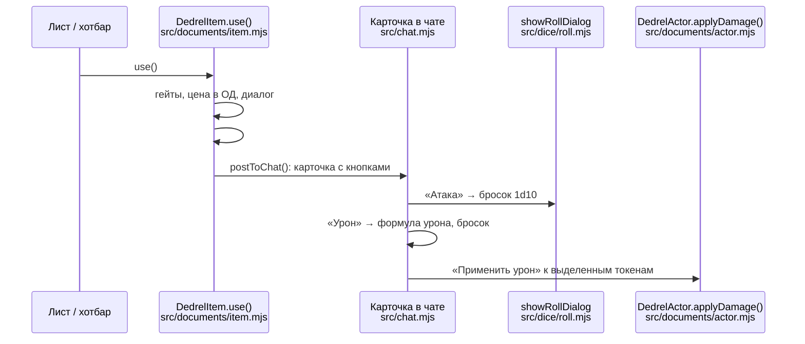

# Поток использования предмета и броска

Что происходит от клика по манёвру на листе до урона, вычтенного у цели. Пять
этапов, у каждого свой файл:



## 1. `DedrelItem#use()` — подготовка

Вызывается кликом по предмету на листе (действие `useItem`), с хотбара
(`game.dedrel.rollItemMacro`) или из HUD цепочек. Метод ничего не тратит — только
решает, нужен ли диалог, и собирает для него контекст:

1. **Гейты по типу.** Типы без активного использования сразу публикуют карточку.
   Светильник (предмет с transfer-эффектом `token.light.*`) не используется, а
   переключается. Свиток без привязанного заклинания открывает лист. Свиток требует
   свободную руку. Собранное заклинание проходит ре-валидацию сборки
   (ранг доктрины мог упасть с момента сохранения).
2. **Цена в ОД** — `DedrelBonuses.effectiveApCost()`: базовая `ap_cost` с DSL-скидками
   (`ap_set`, `ap_discount`), глобальными скидками и надбавками из `system.bonuses`;
   затем хук `dedrelPreUseItem`.
   Перезарядка берёт цену у оружия, чтение свитка — у свитка, темп оружия
   (Быстрое −1 / Медленное +1) сдвигает цену атакующих реакций.
3. **Требования.** Нужное оружие (`req_weapon_*`) ищется среди экипированного;
   заряды (`uses_*`), количество для расходников, свитки для манёвра чтения,
   «достать из рюкзака» (лишнее Взаимодействие для неэкипированного предмета).
4. **Ранний выход.** Пассивный предмет без цены, зарядов, требований и полезной
   нагрузки просто открывает свой лист — чтобы не засорять чат. Если цену обнулил
   бафф, ранний выход запрещён: бафф нужно сжечь, а карточку — опубликовать.
5. **Режим действия** — `ActionEconomy.resolveMode()`: Действие хода, Цепь (запуск из
   HUD цепочек) или Реакция (не свой ход). Решается в момент использования: тип
   на карточке манёвра часто двойной.
6. **Диалог** `DialogV2.wait`: выбор оружия, свитка, переменной цены, предупреждения.

## 2. `#confirmUse()` — исполнение

Порядок важен: всё, что может сорваться, проверяется до первой траты.

1. Пересчёт цены для фактически выбранного оружия или свитка (в диалоге она считалась
   по первому подходящему).
2. Проверки: хватает ли ОД, зарядов, количества, заряжено ли оружие, есть ли боеприпас
   у выбранного оружия. При провале — уведомление и выход без трат.
3. Траты: ОД (сначала из профильного пула — боевого или магического, остаток из
   универсального), отметка «Действие потрачено», сжигание DSL-модификаторов стадии
   `use`, заряды, боеприпасы, количество, состояние заряженности оружия.
4. **Self-эффекты** — эффекты предмета с `flags.dedrel.applyTo = "self"` копируются на
   владельца с подстановкой `@spentAp` / `@apCost` / `@overspent`. До макроса, чтобы
   `on_use_macro` видел бафф уже наложенным.
5. `on_use_macro`, если задан (`scope.actor`, `scope.item`, `scope.spentAp`, `scope.weapon`).
6. Публикация: свиток и магический предмет с привязанным заклинанием кастуют его,
   остальные вызывают `postToChat()`.
7. Маркер концентрации у заклинаний, показ HUD цепочек, удаление израсходованного
   до нуля предмета — в самом конце, когда карточка уже опубликована.

## 3. `postToChat()` — карточка

Карточка — HTML с описанием и кнопками `.dedrel-chat-action[data-action]`. Какие кнопки
появятся, решают поля предмета:

| Кнопка | Когда |
|---|---|
| Атака (`rollAttack`) | у манёвра есть формула атаки, требование оружия или навык; у заклинания — формула атаки или урона |
| Урон (`rollDamage`), урон двуручным хватом | формула урона или (у манёвра) требование оружия; вторая кнопка — для оружия с переменным хватом |
| Исцеление, временные ХП | `formula_heal`, `formula_temp_hp` |
| Спасбросок (`rollSave`) | `save_attribute` |
| Наложить состояние | у заклинания: выбранное состояние Модификатора «Сила», черта «Адаптации», уникальное свойство доктрины («Поджигание») |
| Шаблон области, конус картечи | `template_shape` + `template_size`; оружие с `is_scatter` |
| Применить эффекты | у предмета есть эффекты с `transfer: false`, кроме self и аур |
| Аура | эффект-маркер с `flags.dedrel.aura` |

Флаг `hide_combat_buttons` убирает боевые кнопки (утилитарные манёвры с оружием).
Данные, которые понадобятся позже, но к моменту клика могут исчезнуть, едут в самой
карточке: формула лечения выпитого зелья — в data-атрибуте, снимок свойств
израсходованного боеприпаса — во флаге сообщения `flags.dedrel.ammo`.

## 4. Броски — `src/chat.mjs` и `src/dice/roll.mjs`

**Атака** (`rollAttack`): навык берётся у манёвра, иначе у оружия; ранг навыка уходит
в `showRollDialog`, где игрок отмечает специализацию (+2), ситуативный бонус и штраф.
Затем `executeRoll` собирает формулу:

```
1d10xo10  + ранг навыка + специализация + бонус диалога
          + DSL attack (+ точность собранного заклинания)
          + системные бонусы (global_roll / global_skill / бонус навыка)
          − штраф диалога − штраф ран
```

`xo10` — взрыв один раз на десятке; бонус `infinite_explode` меняет его на бесконечный
`x10`. Натуральная единица бросает второй d10 на подтверждение критического провала;
у огнестрела единица ещё и осечка, тяжесть которой зависит от редкости оружия.
После броска сгорают DSL-модификаторы стадии `roll`. Перед сборкой формулы
вызывается хук `dedrelPreRoll`.

**Урон** (`rollDamage`):
1. Формула — своя у манёвра, иначе у оружия; при нескольких допустимых типах урона
   выбирается тот, что у оружия есть и в среднем бьёт сильнее.
2. Сдвиг по Лестнице урона: собственный сдвиг манёвра + DSL `dice_step` + двуручный
   хват. **Правило Лестницы:** суммарное повышение не больше одной ступени,
   понижение не ограничено.
3. Добавки: DSL `damage`, урон боеприпаса того же типа; бонус `damage_explode`
   делает кости взрывными.
4. Бронебойность = поле оружия + DSL `pierce` + боеприпас. Каждая единица гасит 10% DR цели.
5. Сгорают DSL-модификаторы стадии `damage`.

**Спасбросок** (`rollSave`) бросает выделенный токен (или персонаж игрока) по рангу
характеристики, с бонусами `global_save` и бонусом спасброска этой характеристики.

## 5. `DedrelActor#applyDamage()` — урон по цели

Кнопка «Применить урон» под броском урона действует на выделенные токены, а если их
нет — на цели игрока. Менять чужого актора может только владелец, поэтому кнопку
обычно нажимает ГМ.

1. Бонус «против типа существ» (оружие + боеприпас): максимальная мощь среди типов
   цели, +10% урона за единицу мощи — до вычета DR.
2. DR по типу урона (`system.dr.<тип>`, единица = 10%), минус бронебойность. Оружие-
   «вскрыватель» типа существ игнорирует ту часть DR, которую цели дал этот тип.
   Отрицательный DR — уязвимость, урон растёт.
3. Сначала сгорают временные ХП, остаток снимается с ХП. У NPC-массовки (`tier: peon`)
   вместо ХП — «попадания»: удар не слабее Прочности снимает одно попадание.

Тот же метод вызывают тики периодического урона состояний (`src/combat.mjs`), поэтому
математика DR одинакова для всех источников.

## Стадии DSL-модификаторов

DSL-бонус «на следующий манёвр» (`flags.dedrel.mod`) сгорает в одной из трёх стадий
использования. Стадию задаёт параметр `consume`, а без него она зависит от операции:

| Стадия | Где наступает | Операции по умолчанию |
|---|---|---|
| `use` | `#confirmUse()`, после траты ОД | `ap_set`, `ap_discount` |
| `roll` | `executeRoll()`, после броска атаки | `attack` |
| `damage` | обработчик `rollDamage`, после броска урона | `damage`, `dice_step`, `pierce` |

Эффект сгорает целиком в самой поздней стадии среди его строк, совпавших с предметом
по фильтру: «−1 ОД и +2 к атаке» на одном эффекте доживёт до броска атаки. Строки
с `consume:never` не сгорают никогда. Удаляется сам эффект на акторе или
condition-предмет, который его несёт; на постоянном носителе (талант, оружие) одноразовый
модификатор не сгорит — движок предупредит в консоли.

Синтаксис, фильтры и параметр `consume` — [effect-keys.md](effect-keys.md) §2.2,
готовые рецепты — [system-macros.md](system-macros.md).
